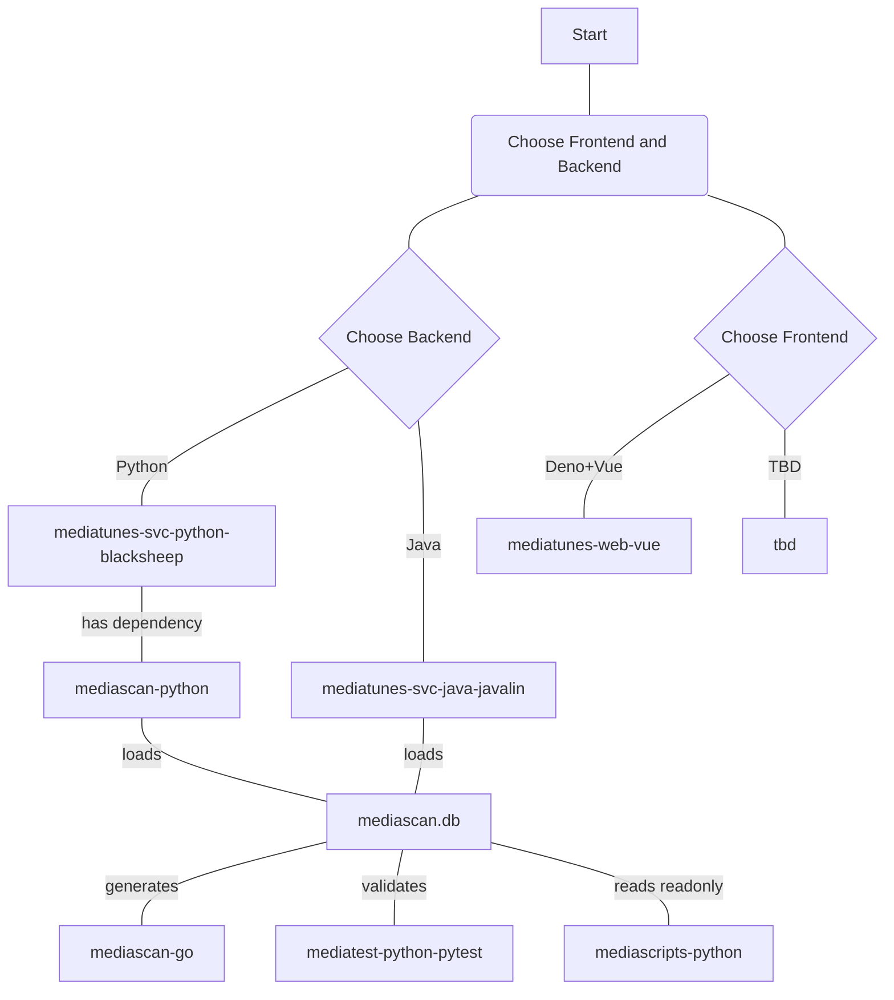

# moongas-mediascripts-python  

> 🚧 **Status: Work in Progress (WIP)**  
> This project is currently under active development. Features, APIs, and documentation are subject to change.

---

## Overview

**Python scripts for working with Moongas media collections.**

### A component of the `moongas` ecosystem of media library tools

- [moongas-collection-demo](https://github.com/moongas-org/moongas-collection-demo) [](https://github.com/moongas-org/moongas-collection-demo/actions/workflows/ci.yml) - Example Moongas media collection (metadata only)
- [moongas-mediatunes-web-vue](https://github.com/moongas-org/moongas-mediatunes-web-vue) [](https://github.com/moongas-org/moongas-mediatunes-web-vue/actions/workflows/ci.yml) - A Deno-tooled TypeScript/Vue SPA for Moongas hybrid media collections, pairing with the separate moongas-mediatunes-svc-python-blacksheep backend to seemlessly blend offline and streaming playback
- [moongas-mediatunes-svc-python-blacksheep](https://github.com/moongas-org/moongas-mediatunes-svc-python-blacksheep) [](https://github.com/moongas-org/moongas-mediatunes-svc-python-blacksheep/actions/workflows/ci.yml) - Python+BlackSheep implementation of API service for Moongas hybrid media collections—backend for Moongas mediatunes web application (moongas-mediatunes-web-vue)
- [moongas-mediatunes-svc-java-javalin](https://github.com/moongas-org/moongas-mediatunes-svc-java-javalin) [](https://github.com/moongas-org/moongas-mediatunes-svc-java-javalin/actions/workflows/ci.yml) - Java+Javalin implementation of API service for Moongas hybrid media collections—backend for Moongas mediatunes web application (moongas-mediatunes-web-vue)
- [moongas-mediascan-go](https://github.com/moongas-org/moongas-mediascan-go) [](https://github.com/moongas-org/moongas-mediascan-go/actions/workflows/ci.yml) - Golang module to scan media collections and Moongas Yaml metatadata, outputs Moongas database
- [moongas-mediascan-python](https://github.com/moongas-org/moongas-mediascan-python) [](https://github.com/moongas-org/moongas-mediascan-python/actions/workflows/ci.yml) - Python library with data classes for loading Moongas mediascan databases and Yaml metadata files
- [moongas-mediascripts-python](https://github.com/moongas-org/moongas-mediascripts-python) [](https://github.com/moongas-org/moongas-mediascripts-python/actions/workflows/ci.yml) - Python scripts for working with Moongas media collections.
- [moongas-mediatest-python-pytest](https://github.com/moongas-org/moongas-mediatest-python-pytest) [](https://github.com/moongas-org/moongas-mediatest-python-pytest/actions/workflows/ci.yml) - Python tool for enforcing media collection rules (implemented with `pytest`)

## Live Demos
- [Live Demo (hosted on moongas.org)](https://moongas.org/mediaserver)
- [Live Demo (hosted on moongas.org)](https://moongas.org/mediaserver)



# Quick Start

```bash
uv tool install "mediascripts[stats] @ git+https://github.com/moongas-org/moongas-mediascripts-python.git"
```

### (Developer) Clone GitHub repo and install (editable)

```bash
git clone git@github.com:moongas-org/moongas-mediascripts-python.git
cd moongas-mediascripts-python
uv sync --extra dev --extra llm --extra stats
```

### Optional dependency groups

- `[dev]` - development dependencies (includes `pytest` and `ruff`)
- `[stats]` - statistics script dependencies (includes `matplotlib` and `numpy`)
- `[essentia]` - Essentia audio feature extraction (`uv sync --extra essentia`)
- `[lyrics]` - local lyrics transcription using faster-whisper with int8 quantization (`uv sync --extra lyrics`)
- `[lyrics-align]` - optional forced alignment of supplied `.txt` lyrics for Python <3.14 (`uv sync --extra lyrics-align`)

# Usage

### Populate one artist directory

```bash
artist-yaml-auto-populate --dir "/music/Artist"
artist-yaml-auto-populate --dir "/music/Artist" --artist "Artist" --artist "Alias" \
  --city "London" --country-code GB --region-code GB-LND --language-code en
artist-yaml-auto-populate --dir "/music/Artist" --llm=false
```

`--dir` and `--file` are mutually exclusive. If `artist.yml` is missing,
`--dir` creates a minimal `artistData` document. Artist names come from explicit
`--artist` values first, then track YAML in immediate album subdirectories,
then media tags in those same directories. Album artist is preferred over
track artist; conflicting names use the most frequent value, with sorted
file order breaking ties and a warning describing the decision. As a last
resort, the artist directory name is used (`_` becomes `.`).

`--artist` and `--language-code` are repeatable. These and `--city`,
`--country-code`, and `--region-code` seed new files only and require `--dir`.
Unknown location/language values stay empty rather than being guessed from
track metadata. Unreadable local clues are warned about and skipped.
Existing artist YAML files are never overwritten by the seeding step.

After creation, the selected file enters the existing LLM enrichment flow,
even when outside the configured collection. Newly created files bypass the
already-valid skip once; existing files retain normal validation/`--force`
behavior. `--llm=false` creates a missing file using local clues only, without
calling the model. Default collection-wide behavior is unchanged.

### Tag a media file

```bash
auto-tag-media-file --file "/music/Artist/Album [2024]/05 - BIG 5.mp3" -n
auto-tag-media-file --file "/music/Artist/Album [2024]/05 - BIG 5.mp3"
auto-tag-media-file --file track.flac --artist "Artist" --album-artist "Artist" \
  --album "Album" --title "Title" --genre "Hip-Hop" --year 2024 --cover cover.jpg
python -m mediascripts.mediafile.auto_tag_media_file --help
```

Explicit arguments override same-basename `.yml` / `.yaml` `trackData` values
(`track_data` is also accepted). Missing or empty YAML values fall back to the
artist directory, album directory, bracketed album year, and filename without
its leading track number. The artist directory supplies both artist and album
artist unless overridden. Existing differing text tags are updated; unrelated
tags and artwork are preserved. `--genre` matches mediascan
`Genre` enum values case-insensitively, ignoring hyphens, and writes the enum's
canonical spelling (for example, `--genre jazz` writes `Jazz`, and
`--genre synthpop` writes `Synth-pop`); invalid CLI values log
an error and exit before reading or modifying the media file, even in dry-run.
An invalid YAML genre causes the genre field to be cleared with a warning,
unless overridden by a valid CLI genre. Without a CLI/YAML genre,
existing file genres are checked; if any value is invalid the whole genre
field is cleared. Dry-run warns and proposes clearing without saving.
When no valid genre is supplied by the CLI, target track YAML, or existing
target tags, the script infers the most common valid genre from other tracks
in the same album and immediate sibling album directories under the artist.
Each neighboring track counts once, preferring its valid YAML genre over
media tags; duplicate formats do not multiply votes. The target track is
excluded. Only exact enum values count; ties use alphabetical order.
The counts and selected genre are logged, unreadable clues are warned about,
and neighboring files are never modified. If no valid clues exist, no genre
is added. Dry-run shows the proposed inferred genre without saving.
Other invalid metadata is reported, not silently ignored.

When the filename begins with a number from 1 through 99, that number sets the
track-number tag: both `05 - BIG 5.mp3` and `5 BIG 5.mp3` yield track 5.
Use `--track 7` to set the track number explicitly, overriding the filename,
and `--disc 1` to set the disc number. Both accept `number` or `number/total`,
with positions from 1 through 99 and optional totals from 1 through 65535.
Explicit options replace the whole field: `--track 1 --disc ""` sets track
1 without a total and removes the disc field, while `--track "1/10" --disc "1/2"`
sets both positions and totals. An empty string clears either field; omitting
`--disc` preserves existing disc metadata.
Filename-inferred track numbers preserve existing totals. Missing
or out-of-range prefixes leave existing track numbers unchanged; out-of-range
prefixes are logged as warnings. Track-number changes also respect dry-run.

Use `--comment "Notes"`, `--composer "Composer"`, and `--copyright "Copyright"`
to set these optional tags. Omitted options preserve existing values; an
explicit empty string (for example, `--comment ""`) removes the field.
Setting or clearing an ID3 comment replaces/removes all comment frames,
including comments with different descriptions or languages. Other formats
use their native equivalent tags. These options also respect dry-run.

Path reconstruction is best-effort: `_` becomes `.` to reverse the main
replacement in the album-file renamer. Its other transformations are lossy:
an underscore could originally have been a dollar sign or asterisk, and
`and` could have been `&`. These cannot be reliably recovered; use YAML or
explicit arguments for exact spelling. YAML and argument values are not
unescaped.

Missing artwork is filled from a sibling `cover.jpg` or `cover.webp`,
preferring JPEG over WebP and the largest file within that preference
(including case variants). `--cover` selects a specific JPEG, PNG, or WebP
instead, but never replaces existing artwork. WebP is converted in memory to
JPEG for MP4/M4A embedding; the source image is not changed.

MP3 and WAV use ID3; FLAC, Ogg/Opus, MP4/M4A, and WMA use their native metadata.
Recognized extensions that Mutagen cannot write (such as raw AAC, MKV, and
WebM) report an error rather than inserting incompatible ID3 data. All changes
are logged after a successful save. `-n` / `--dry-run` validates and logs the
same proposed changes without writing either the media file or YAML.
Every successful run prints the final artist, album artist, album, title,
genre, year, track number, disc number, comment, composer, copyright, and
cover-art presence, including unset fields. Values are read back from the file;
dry-run shows proposed in-memory values clearly labeled as unsaved.
With `-v` / `--verbose`, successful runs additionally print all tags from the media
file, including unchanged tags, plus FLAC picture summaries. Verbose dry-run
instead prints the proposed in-memory tags, clearly labeled as unsaved.
Binary artwork is summarized rather
than dumped as raw bytes where supported by Mutagen's tag formatter.

### Populate text lyrics from LRCLIB with local transcription fallback

`lyrics-text-auto-populate` first looks up each missing `.txt` lyrics file via
LRCLIB, then falls back to local faster-whisper transcription if no lyrics are
available. faster-whisper uses int8 quantization. Existing lyrics files are
never overwritten.

```bash
uv sync --extra lyrics
lyrics-text-auto-populate                                  # LRCLIB, then local fallback
lyrics-text-auto-populate --lookup=false                   # local transcription only
lyrics-text-auto-populate --transcribe=false               # LRCLIB only
lyrics-text-auto-populate --file "/path/to/01 - Track.mp3"
lyrics-text-auto-populate --dir "/path/to/album" --sleep 1
lyrics-text-auto-populate --retry-not-found --model medium --language en --cpu
```

`--lookup=false` disables LRCLIB; `--transcribe=false` disables the local
fallback. Using both false lists missing lyrics files without doing lookups or
loading a model. Cached LRCLIB misses skip repeat requests but still proceed to
local transcription. Transcription failures are counted as errors while the
batch continues. Model weights may download on first use.

The local-transcription-only command is also available:

```bash
uv sync --extra lyrics
lyrics-text-auto-populate-from-file                         # collection album tracks
lyrics-text-auto-populate-from-file --file "/path/to/01 - Track.mp3"
lyrics-text-auto-populate-from-file --file "/path/to/01 - Track.yml"
lyrics-text-auto-populate-from-file --dir "/path/to/album"   # non-recursive
lyrics-text-auto-populate-from-file --transcribe=false      # sorted listing only
lyrics-text-auto-populate-from-file --cpu --model medium --language en
python -m mediascripts.lyrics.lyrics_text.lyrics_text_auto_populate_from_file --help
```

The model loads once per batch (`small` by default) with int8 quantization;
weights may download on first use. `--device` selects a faster-whisper device,
with `--cpu` taking precedence. `--language` defaults to `en`. Transcribed segments
are saved as plain text, one nonempty segment per line, without timestamps.
Speech recognition can mishear singing or hallucinate lyrics on instrumental
audio; review generated text before using it for LRC alignment.

Only media tracks without a sibling `.txt` are processed, in random order.
Existing lyrics, including files created during transcription, are never
overwritten; LRC files and media files are left untouched. With no target,
album directories under `$MOONGAS_COLLECTION_ROOTDIR/data` are scanned,
including library symlinks. `--file` and `--dir` are mutually exclusive.
Track YAML input resolves to sibling media using the preference order below;
without media it reports an error. Empty transcription and processing failures
are logged and return a nonzero exit status while other tracks continue.
`--lookup=false` aliases `--transcribe=false`; listing and no-work runs do not
load faster-whisper. No lookup cache or network pacing options are needed for
this standalone transcription command.

### Generate synchronized LRC lyrics locally

Run `uv sync --extra lyrics`. By default, LRC files are generated from
faster-whisper transcription segments, using int8 quantization and timestamps
from the recognized audio. Model weights may download on first use; subsequent
runs can use the cached weights offline. No system FFmpeg, lyrics lookup
service, or OpenAI API key is needed for this default mode.

```bash
lyrics-lrc-auto-populate                          # eligible collection album tracks
lyrics-lrc-auto-populate --file "/path/to/01 - Track.mp3"
lyrics-lrc-auto-populate --file "/path/to/01 - Track.yml"
lyrics-lrc-auto-populate --dir "/path/to/album"    # this directory only
lyrics-lrc-auto-populate --align=false            # list eligible tracks, without loading a model
lyrics-lrc-auto-populate --cpu                    # force CPU mode instead of CUDA
lyrics-lrc-auto-populate --dir "/path/to/album" --model medium --language en --device cpu
uv sync --extra lyrics-align
lyrics-lrc-auto-populate --use-lyrics-txt          # force-align existing .txt lyrics instead
python -m mediascripts.lyrics.lyrics_lrc.lyrics_lrc_auto_populate --help
```

By default, media tracks without an existing `.lrc` are transcribed and their
recognized segments are timestamped. Existing `.lrc` files are never
overwritten. The optional `--use-lyrics-txt` mode instead requires a sibling
UTF-8 `.txt` file and force-aligns its lines with WhisperX; install the
`lyrics-align` extra and system FFmpeg for this mode. WhisperX currently
supports Python versions below 3.14. Existing text lyrics remain untouched.
The default target is
album directories under `$MOONGAS_COLLECTION_ROOTDIR/data` (including library
symlinks), with the same fallback root as `lyrics-text-auto-populate`.
`--file` and `--dir` are mutually exclusive.

Both `lyrics-text-auto-populate --file` and `lyrics-lrc-auto-populate --file`
accept a media file or a track YAML file (`.yml` / `.yaml`). The final extension
is stripped to identify sibling lyrics files; YAML contents are not parsed.
For YAML input, a same-basename media file is selected in this preference order:
`.mp3`, `.m4a`, `.flac`, `.ogg`, `.opus`, `.wav`, `.wma`, `.aac`, then video
formats `.mp4`, `.webm`, `.mkv`. Extension matching is case-insensitive.
An explicitly selected media file is used unchanged, preserving embedded-tag and duration
lookup for text lyrics and supplying the actual audio for LRC alignment.
Without sibling media, the text script can still look up lyrics using the
filename and artist/album directories; the LRC script reports an error because
alignment requires local audio.

Both scripts share media resolution, lyrics paths, logging configuration, and
atomic non-overwriting lyrics writes in `mediascripts.lyrics.lyrics_common`.

Eligible tracks are processed once per run in random order, using the same
shared file-shuffling helper as track YAML auto-population. Listing mode
(`--align=false`) keeps sorted order, and `--file` still selects only one track.

In default mode, the faster-whisper model is loaded once per batch (`small` by
default); `--model` also accepts a local checkpoint path. `--language` defaults
to `en`; `--device` defaults to automatic device selection, and `--cpu` forces
CPU mode. The script writes one timestamped LRC line per recognized segment.
With `--use-lyrics-txt`, WhisperX aligns the existing text and preserves its
line breaks with one `[mm:ss.xx]` timestamp per line; the alignment model uses
the selected language and device. Empty text, failed transcription or
alignment, and write failures are logged, do not leave a partial LRC, and
produce a nonzero exit status; other tracks continue processing.

`--lookup=false` is an alias for `--align=false`, for compatibility with the
text-lyrics script's listing mode. Network pacing (`--sleep`) and lookup-cache
options (`--retry-not-found`) do not apply to local alignment.

### AcoustID fingerprint lookup

Set `ACOUSTID_API_KEY` to your AcoustID client API key, then run:

```bash
acoustid                         # all track YAML files under $MOONGAS_COLLECTION_ROOTDIR/data
acoustid --dir /path/to/album     # recursively scan one directory
acoustid --file "/path/to/01 - Track.yml"
acoustid --count 10 --dry-run     # query up to 10 eligible tracks without writing
acoustid --force --dir /path/to/album  # re-query tracks that already have acoustidData
acoustid --force --overwrite --dir /path/to/album  # also rewrite unchanged lookup results
acoustid --dry-run --offline       # print request URLs without contacting AcoustID
python -m mediascripts.acoustid.acoustid --help
```

`--file` and `--dir` are mutually exclusive. Both `.yml` and `.yaml` files are
supported; collection metadata files such as `artist.yml`, `album.yml`, and
`files.yml` are excluded. A track must have a `trackData` mapping and a
`mediaFileData` entry containing `fpcalcData.fingerprint` and a positive numeric
`fpcalcData.duration` in seconds. Missing fingerprints or invalid durations are
warned about and skipped; this script does not run `fpcalc`.

`-c` / `--count` limits eligible tracks, not individual requests; zero processes
none. By default, fingerprint entries that already have non-empty `acoustidData`
are skipped without a request (logged at INFO), and tracks with nothing left to
look up don't count toward `--count`. Pass `--force` to query them again; a
response is replaced only when it changes.
All returned matches, scores, recording data, and additional response fields are
retained; no best-match selection is implied.

The script calls AcoustID over HTTPS with
`meta=recordingids&meta=releases&meta=releasegroups&meta=isrcs`, pacing requests
below the service's three-per-second limit within a single process. `--sleep`
sets the minimum seconds between requests; it defaults to `1/3 + 0.01`
(about 0.343) and rejects smaller values. Avoid running
multiple instances against the same API key. Each request's method, full URL,
headers, and timeout are logged, together with the HTTP status and full response
JSON pretty-printed with two-space indentation (including HTTP error bodies).
Invalid JSON is logged verbatim with a warning. The API key is redacted
throughout. `-n` / `--dry-run` still performs and logs lookups. For each proposed
change it writes a track YAML file in a unique `/tmp/acoustid-proposal-*`
directory and prints a shell-quoted `meld` command comparing the existing file
with the proposal. Source files and backups remain unchanged. Proposals remain
available for review; remove their temporary directories when finished.
Add `--offline` (only valid with `--dry-run`) to skip the API entirely: each
request URL the script would have sent is printed to stdout, with the API key
replaced by `[REDACTED]`, and no sleeping, proposals, or file changes occur.
`--count` and the existing-`acoustidData` skip still apply.

The successful API response is saved as `acoustidData` (the YAML spelling of
`MediaFileData.acoustid_data`) alongside `fpcalcData` in the matching
`mediaFileData` entry. ISRC lists are written independently, without YAML anchors
or aliases. Strings use the YAML writer's normal quoting rules. Only this portion is updated; existing metadata,
fingerprints, legacy identifier lists, other entries, and YAML comments are
preserved. `track-yaml-auto-populate` accepts and preserves this response.
Changed
files are saved atomically with an original-content `.bak` backup, and a
shell-quoted `meld` command compares the backup against the modified file.
Successful no-match responses (`results: []`) are saved too; identical responses
leave files unchanged unless `--overwrite` is specified. `--overwrite` rewrites
YAML after a successful lookup even when the response is unchanged, using the
usual backup and `meld` workflow (or a proposal in dry-run mode). It does not
force lookups for populated tracks; combine it with `--force` for that.
Rewriting lets the YAML writer remove unnecessary double quotes, while keeping
quotes required to preserve string types. Skipped tracks and offline runs are
not rewritten by this option. Errors are logged and produce a nonzero exit
status without saving the failed track.

### Spotify track identifiers

The Spotify package separates API requests, rate limiting, and caching into
`client.py`, track identifier validation and YAML updates into `track_yaml.py`,
and command-line orchestration into `spotify.py`.

Set `SPOTIFY_API_CLIENT_ID` and `SPOTIFY_API_CLIENT_SECRET` to your Spotify
Developer application credentials, then run:

```bash
spotify                              # tracks under $MOONGAS_COLLECTION_ROOTDIR/data
spotify --file "/path/to/01 - Track.yml"
spotify --dir /path/to/album --count 10 --dry-run
spotify --dry-run --offline           # preview search URLs; no credentials needed
spotify --force --overwrite           # re-query populated entries and rewrite unchanged matches
python -m mediascripts.spotify.spotify --help
```

Spotify accepts the same mutually exclusive `--file` / `-d, --dir`,
`-c, --count`, `-n, --dry-run`, `--offline`, `--force`, `--overwrite`, and
`--sleep` options as AcoustID and MusicBrainz. Directory scans follow library
symlinks and exclude collection metadata files. Discovered track files are
collected and processed in random order rather than traversal order. The count
limits eligible track files, not individual ISRC requests.

ISRCs are collected from `trackIdData.streamingData[]` and
`mediaFileData[].acoustidData.results[].recordings[].isrcs`, deduplicated, and
searched in reverse alphabetical order (`US...` before `AUS...`). Search values
are trimmed, uppercased, and stripped of hyphens without changing source ISRCs.
An empty `tracks.items` response advances to the next ISRC after the normal
request-spacing delay, until a match is found or all candidates are exhausted.
The first ISRC returning a match wins; if Spotify returns multiple tracks, the
first result is used. A `streamingData` entry with `streamingService: spotify`,
`trackId`, `trackUrl`, the complete search response in `apiData`, and the source
`isrc` is added to the scalar `trackIdData` mapping. If ISRCs are available only
in `mediaFileData`, they are associated with that mapping, which is created if
needed.
Spotify response payloads, track metadata, and source ISRC values are not
modified. Malformed YAML is reported, not restored from backups, so unrelated
fields cannot be changed through automatic recovery.

Entries with a complete Spotify streaming record are skipped unless `--force`
is used. Incomplete records are filled when existing values agree with the
result; conflicting values are logged and left unchanged unless forced.
No-match results never erase existing fields. Successful searches, including
empty results, are cached per ISRC for the run, and failed ISRCs are not
retried again after exhausting their attempts.

Requests have a 30-second timeout and are spaced at least `--sleep` seconds
apart (default and minimum: 1.01). This is a conservative interval, not a
guarantee against Spotify's application-dependent rate limits. HTTP 429
`Retry-After` delays are honored. HTTP 503 adds 0.5 seconds of temporary extra
sleep; successful searches reduce it by 0.1 seconds. Expired-token HTTP 401
responses trigger reauthentication. Network errors, invalid responses, and
retryable HTTP errors get up to five attempts per ISRC; other 4xx responses
are not retried. Failures are logged and produce a nonzero exit status while
other entries and files continue processing.

Requests, statuses, and pretty-printed search responses are logged with bearer
tokens redacted; authentication bodies and credentials are never logged.
Changed files are saved atomically with an original-content `.bak` backup and
a shell-quoted `meld` command. Dry runs still query Spotify but retain proposals
under `/tmp/spotify-proposal-*`, print `meld` commands, and leave sources and
backups untouched; remove proposals when finished. Offline dry runs print
candidate search URLs without authentication, requests, sleeping, or writes.
`--overwrite` rewrites unchanged successful matches only; it does not bypass
the populated-entry skip, so combine it with `--force` when needed.

### MusicBrainz recording details

Run `musicbrainz` after `acoustid` to fill in each AcoustID recording's
MusicBrainz details. These are the optional `TrackAcoustIDRecording` fields
`title`, `length` (milliseconds), `video`, `disambiguation`, `firstReleaseDate`
(from MusicBrainz `first-release-date`), and `isrcs`:

```bash
musicbrainz                         # all track YAML files under $MOONGAS_COLLECTION_ROOTDIR/data
musicbrainz --file "/path/to/01 - Track.yml" --dry-run
musicbrainz --dry-run --offline     # print request URLs without contacting MusicBrainz
musicbrainz --force --overwrite     # rewrite even when recording details are unchanged
musicbrainz --reverse --count 10    # start with the last eligible tracks in normal traversal order
```

It accepts the same `--file`, `--dir`, `-c/--count`, `-n/--dry-run`,
`--offline`, `--force`, `--overwrite`, and `--sleep` options as `acoustid`.
Additionally, `--reverse` processes files in the exact reverse of the normal
collection or `--dir` traversal order, with `--count` applied in that reversed
order. It collects the discovered paths before processing; the default traversal
is unchanged. Recording order within each file is unchanged, and `--file` still
processes just that file. No API key is needed.
Each recording ID under `mediaFileData[].acoustidData.results[].recordings[]`
whose `isrcs` is missing or empty is requested from
`https://musicbrainz.org/ws/2/recording/<id>?inc=isrcs&fmt=json`. Recordings
with no ISRCs in MusicBrainz therefore keep an empty list and are checked again
on later runs. `--force` also re-queries recordings that already have ISRCs.
Requests are spaced at least 1.01 seconds apart (MusicBrainz allows one per
second), and IDs repeated within a run are requested only once. Each HTTP 503
adds 0.5 seconds of temporary extra sleep between requests; each later 2xx
response removes 0.1 seconds, down to zero. Requests, pretty-printed responses,
sleeps, and extra-sleep changes are logged.

Each recording ID gets at most five attempts per run, with the usual sleep
between them. HTTP errors other than 404, network errors, and invalid responses
each count as a failed attempt. After five failures that recording is left
unchanged and the script moves on to the next recording ID. Other recordings in
the same track are still saved, the ID isn't requested again later in the run,
and the exit status is nonzero. HTTP 404 is not retried and leaves that
recording unchanged. Invalid recording IDs are skipped with a warning.

Every field except `id` is replaced from the response; fields MusicBrainz omits
or returns as `null` are stored as `null` (`isrcs` as `[]`). Other keys are left
alone, and `id` is never changed, even when MusicBrainz returns a merged
recording. Saving, `.bak` backups, dry-run proposals
(`/tmp/musicbrainz-proposal-*`), and `meld` commands work as for `acoustid`. A
normal run replaces any existing `.bak`, including one written by `acoustid`.
`--overwrite` also rewrites unchanged recording details after a successful
lookup, including a result cached earlier in the run. Combine it with `--force`
to include recordings that already have ISRCs. Normal YAML quoting rules apply;
unnecessary double quotes are removed on rewrite. Skipped, offline, failed,
and not-found lookups do not trigger an overwrite.

Logs identify the track, each recording's progress and attempt number, and
whether its fields changed in memory. The track is saved only after all its
recording entries finish; `--overwrite` does not save after each response.
Completion logs explain whether YAML was written, a dry-run proposal was
created, or no write was needed, and include the `meld` command in the logs as
well as stdout. Interrupting a track discards its pending in-memory updates;
previously completed tracks remain saved.

Both lookup scripts expand existing shared ISRC lists even when a recording's
lookup would otherwise be skipped. Ordinary unquoted string lists are valid
and do not need repair. Missing optional
fields remain missing; an explicitly malformed ISRC value is logged and reset
to `[]`, allowing `musicbrainz` to look it up again. This repair does not consume
`--count` when no lookup is needed.

If a track YAML cannot be parsed and its `.bak` is a loadable track document,
the scripts restore that backup before processing it. A missing or invalid
backup causes an explicit error instead of overwriting the track. Dry runs
use the backup in memory and leave source files and backups untouched; offline
mode never writes repairs. Repaired output follows the usual backup/proposal
and `meld` workflow.

YAML `&id001` defines an anchor and `*id001` references it; these are valid YAML,
not ISRC strings. Sharing one cached list between recording entries previously
caused ruamel to emit these references. Each entry now gets an independent list,
and existing references are expanded without losing their identifiers.

The current source targets `mediascan` 1.2.5 or newer: metadata types and YAML
helpers under `mediascan.types`, and database
loading under `mediascan.utils.db.mediascan_db_loader`. When developing against
that sibling checkout, install its current source into the project environment
(`uv pip install --python .venv/bin/python --editable ../moongas-mediascan-python`); an older installed wheel may
still use the previous module layout.

The `mediascripts` package installs a console script named `mediascripts` so it can be executed either with `python -m mediascripts` or simply with `mediascripts`.

```bash
$ mediascripts --h
usage: mediascripts [-h] [--list] [--create-script-symlinks]

Utility for media* console script entry points.

options:
  -h, --help            show this help message and exit
  --list                list all media* console script entry points, grouped by scripts subdirectory
  --create-script-symlinks
                        create hyphenated symlinks in the current directory to every console entry script and every shell script in
                        scripts/shell
```

The `--list` option may be used to list all console scripts and shell scripts installed by any `media*` packages.
```bash
$ mediascripts --list
artist:
  artist-countries-to-mapgraph-json
  artist-yaml-auto-populate
  artist-yaml-reformat
  artist-yaml-test
  list-missing-region-names
convert:
  convert-covers
  convert-videos
  make-covers-video
copy:
  copy-medialib
dev:
  generate-dataclasses
lyrics:
  lyrics-lrc-auto-populate
  lyrics-text-auto-populate
  lyrics-text-auto-populate-from-file
mediascan_db:
  list-albums
  list-artists
  list-mediafiles
  list-tracks
  list-trackstreaming
rename:
  rename-album-files
stats:
  genre-clusters
track:
  compare-track-yaml-with-media-file
  merge-track-yaml-with-media-file
  scan-media-files-to-track-yaml
  track-yaml-auto-populate
```

## Copy Media Library Diagnostics

`copy-medialib` logs its source, destination, filters, and overwrite settings
at INFO level. After scanning, it reports how many filenames matched the
include patterns and counts each skip reason. Matching files skipped because
of exclude keywords, identical content, or destination overwrite rules are
also logged at INFO; unmatched filenames remain DEBUG-only.

An empty `--exclude-keywords` value matches every source path and excludes
all included files; the script warns explicitly about this. Check shell
wrappers that build arguments from `COPY_MEDIALIB_EXCLUDE_KEYWORDS`.
`--overwrite-existing` still skips newer destination files;
`--overwrite-newer` permits replacing those files instead.

## Scan Media Files into Track YAML

Populate or refresh the `mediaFileData` entry in each track YAML file from a
matching media file in the same directory:

```bash
scan-media-files-to-track-yaml
scan-media-files-to-track-yaml --file "/path/to/Some Song.yml"
scan-media-files-to-track-yaml --dir "/path/to/music" --count 10
scan-media-files-to-track-yaml --dir "/path/to/music" --dry-run
```

By default, the script scans track YAML files under
`$MOONGAS_COLLECTION_ROOTDIR/data`. It matches media files by basename in the
same directory, selecting the first readable match in filename order. It
creates one `mediaFileData` entry if absent and expects no more than one entry
per track. `path` is stored relative to `MOONGAS_COLLECTION_ROOTDIR` with a
leading `/` (for example, `/data/Music/Artist/Album/Song.mp3`); the media file
must be beneath that collection root. Obsolete `albumPath` and `artistPath`
fields are removed. Size, format, modification time, duration, and tagged
metadata are updated from the media file; missing tag values fall back to
`trackData`. Existing `fpcalcData` and `acoustidData` are preserved.

`--count` limits track YAML files processed; zero processes none. `--dry-run`
prints the proposed diff and a `meld` command without changing source files or
backups. Normal runs preserve the previous YAML in a `.bak` file.

## Auto-Populate Track YAML

The track YAML commands share collection scanning, atomic file writes, and
field-diff formatting through
[`track_yaml_common.py`](./src/mediascripts/track/track_yaml/track_yaml_common.py).

Install the LLM extras (`uv sync --extra llm`) and configure an
OpenAI-compatible provider using `LLM_BASE_URL`, `LLM_API_KEY`, and `LLM_MODEL`.
The existing `GITHUB_MODELS_BASE_URL`, `GITHUB_TOKEN`, and `GITHUB_MODEL`
fallbacks are also supported, as for artist YAML auto-population.

```bash
track-yaml-auto-populate
track-yaml-auto-populate --file "/path/to/01 - Song.yml" --force
track-yaml-auto-populate --dir "/path/to/music" --sleep 10
track-yaml-auto-populate --dir "/path/to/music" --dry-run
track-yaml-auto-populate --count 10
track-yaml-auto-populate --llm=false
track-yaml-auto-populate --dir "/path/to/music" --clean
track-yaml-auto-populate --revert --dry-run
track-yaml-auto-populate --revert
```

By default, scans existing `.yml`/`.yaml` files in album directories beneath
`$MOONGAS_COLLECTION_ROOTDIR/data`, following library symlinks. `--dir` scans
any directory recursively; `--file` processes just one file. Artist, album,
and collection index YAML files are excluded. No media files are changed and
missing sidecars are not created.

Uses the mediascan `TrackYamlFile` schema: `trackData` contains `title`, `artist`,
`albumartist`, `album`, `genre`, and integer `year`; optional `trackIdData` is a
**mapping** containing a `streamingData` list. Each streaming entry has
`streamingService`, `trackUrl`, `trackId`, `apiData`, and optional `isrc`.
Optional `mediaFileData` contains local-file metadata, `fpcalcData` fingerprints,
and `acoustidData` results. Tracks with valid core metadata and at least one
non-empty streaming track ID or URL are skipped unless `--force` is used.
The LLM must preserve `mediaFileData` exactly; it cannot add or change audio
fingerprints, local-file metadata, or AcoustID data.
Up to three complete files in the selected scope serve as reference examples.
Pending tracks are shuffled and processed once per run, with 30 seconds between
requests by default. `--llm=false` only checks files, without creating a client
or changing anything.

`-n` / `--dry-run` requests updates from the LLM, validates the responses, and
shows the proposed diffs without modifying source files or backups.
Each changed result prints a shell-quoted `meld` command. In dry-run mode, the
proposal is retained in a private temporary YAML file so the command remains
usable after the script exits; remove that file when finished reviewing.
Normal runs compare the backup against the updated source.
Normal completion checks, `--force`, and request pacing still apply; this mode
uses provider credentials and may incur API charges. Use `--llm=false` instead
to check files without making requests.
With `--clean`, it logs which backups would be deleted without deleting them.
With `--revert`, it previews restoration without modifying either file.

`--revert` restores track `.yml.bak` files in album directories, replacing each
corresponding `.yml` file and consuming the backup. Replacement is atomic, so a
failed rename does not first delete the current file. Missing `.yml` files are
restored too. It follows library directory symlinks but rejects symlink backups.
It never restores `album.yml`, `artist.yml`, or collection index YAML files,
even with `--file`. `--dir` limits the scan; `--file` selects one track `.yml`
in an album directory. This mode exits without contacting the LLM, is mutually
exclusive with `--clean`, and is not limited by `--count`.

`-c` / `--count VALUE` limits processing to at most that many eligible tracks.
Skipped complete tracks do not count; failed attempts do. The default is
unlimited, and `--count 0` makes no LLM requests. The limit also applies to
dry-run previews, but does not limit backup cleanup with `--clean`.

Responses must pass schema validation and preserve existing non-empty metadata
and identifiers before being saved atomically. Unquoted decimal service IDs
returned by the model are converted to strings, preserving their original digits
(including leading zeros); other invalid identifier types are rejected with the
field path and offending value. Before saving, changed fields
are displayed with their `Track YAML` and `LLM Result` values, including indexed
identifier fields such as `trackIdData.streamingData[0].trackId`. A unified file-content diff
also shows the original/proposed filenames, context lines, and `-`/`+` YAML
lines, including during dry-run. This is informational;
no interactive confirmation is required. Changed files get a sibling
`.yml.bak`/`.yaml.bak` backup. `--clean` removes only track YAML backups in the
selected scope and exits. LLM results still require human review: schema checks
cannot establish that a suggested streaming identifier belongs to the recording.
Exit status is 0 on success, 1 for errors, or 130 if interrupted.
Also runs as `python -m mediascripts.track.track_yaml.track_yaml_auto_populate`.

## Compare Track YAML with MP3 Tags

With `MOONGAS_COLLECTION_ROOTDIR` set, run:

```bash
compare-track-yaml-with-media-file
compare-track-yaml-with-media-file --quiet
compare-track-yaml-with-media-file --dir "/path/to/music" --quiet
```

`-d` / `--dir` recursively scans the specified directory and all subdirectories,
without requiring `MOONGAS_COLLECTION_ROOTDIR` or a collection folder structure.
It takes precedence over the environment variable.

The script walks album directories under `$MOONGAS_COLLECTION_ROOTDIR/data`,
following library symlinks, and compares each MP3 with its sibling `<track>.yml`.
It uses Mutagen to compare the six core `trackData` fields: `title`, `artist`,
`albumartist`, `album`, `genre`, and `year` (against the ID3 date's year).
Leading/trailing whitespace is ignored; additional ID3 values are reported as
differences. Extra tags and streaming identifiers are not compared.

Tracks are skipped before reading YAML or media tags when their artist directory
contains any newline-separated keyword in `COPY_MEDIALIB_EXCLUDE_KEYWORDS`.
The YAML `artist` is also checked when the directory is not excluded. Matching is
case-sensitive, as in the copy scripts; blank lines are ignored. For example:

```bash
export COPY_MEDIALIB_EXCLUDE_KEYWORDS=$'Excluded Artist\nAnother Artist'
```

`-q` / `--quiet` suppresses matching tracks, but still reports differences,
missing YAML or tags, malformed YAML, and unreadable media files.
Files are never modified. Exit status is 0 if all tracks match, or 1 for any
difference or error. It also runs as
`python -m mediascripts.track.track_yaml.compare_track_yaml_with_media_file`.

## Merge Track YAML with MP3 Tags

```bash
merge-track-yaml-with-media-file
merge-track-yaml-with-media-file --dir "/path/to/music" --quiet
```

Uses the same recursive scanning, six-field comparison, and artist exclusions as
the comparison script. For each difference, it displays the track, field, and
both values, then accepts a single shortcut key immediately (no Enter needed):

| Shortcut | Choice | Effect |
|----------|--------|--------|
| `y` or Enter | Accept Track YAML (default) | Updates that ID3 tag from YAML |
| `m` | Accept Media File Tags | Updates that YAML field from ID3 |
| `e` | Enter value | Prompts for a value and saves it to both YAML and ID3 |
| `s` | Skip | Leaves that field unchanged |

Enter still selects the default, Accept Track YAML. After pressing `e`, type the
custom value and press Enter. Redirected/piped input retains line-based choices.
Invalid shortcuts prompt again. Custom values cannot be blank; custom years
must contain four digits. Missing or multiple media values cannot be
copied into a single YAML field; choose YAML, Enter value, or Skip instead. ID3 dates are
compared by year; accepting media tags writes an integer YAML year, while
accepting the YAML year replaces the ID3 date with that year.

Each accepted field is saved immediately. Unrelated media tags and YAML fields,
comments, and quoted strings are preserved using round-trip YAML support.
YAML updates use a temporary file and atomic replacement. `--quiet` suppresses
matching tracks, not conflict prompts or errors. Ctrl+C or end-of-input stops
the run, preserving previously accepted changes.

Exit status is 0 if every conflict is resolved, 1 for skipped conflicts or
errors, and 130 when interrupted. Missing or malformed YAML and unreadable tags
are reported, not synthesized. You can also run
`python -m mediascripts.track.track_yaml.merge_track_yaml_with_media_file`.

## List Mediascan Database Tables

Set `MOONGAS_COLLECTION_ROOTDIR` to the active Moongas collection, then run:

```bash
list-artists
list-albums
list-mediafiles
list-tracks
list-trackstreaming
```

These scripts use the `mediascan` library to open
`$MOONGAS_COLLECTION_ROOTDIR/mediascan.db` and print every row and column of the
`artist`, `album`, `mediafile`, `track`, and `trackstreaming` tables,
respectively, without modifying the database. All headers and values are
left-aligned, with no row, column, or value truncation. The collection variable
and an existing database file are required.

The modules can also be run with
`python -m mediascripts.mediascan_db.list_artists`,
`python -m mediascripts.mediascan_db.list_albums`, or
`python -m mediascripts.mediascan_db.list_mediafiles`,
`python -m mediascripts.mediascan_db.list_tracks`, or
`python -m mediascripts.mediascan_db.list_trackstreaming`.

## `scan-to-album-yaml` - Create Album YAML Files

With `MOONGAS_COLLECTION_ROOTDIR` set and `moongas-mediascan-go` available beneath
that directory, run:

```bash
mediascripts --create-script-symlinks
./scan-to-album-yaml
```

This uses the collection's `mediascan-config.yml` to create missing `album.yml`
files. Existing album YAML files are never overwritten. Additional arguments are
passed through to the Go scanner.

## `show-env` - Show Moongas Environment Variables
```bash
user@host:~/Git/moongas-org/moongas/moongas-collection-local$ ./show-env 
------------------------------------------------------------------------------
                             Moongas Environment                              
------------------------------------------------------------------------------
  MOONGAS_COLLECTION_ROOTDIR:
    "/home/user/Git/moongas-org/moongas/moongas-collection-local"
  MOONGAS_REMOTE_SERVER_IP:
    "159.89.93.193"
------------------------------------------------------------------------------

```

## Nvidia CUDA Pascal Installation (Ubuntu x86_64)

I have a decade old budget graphics card (GTX 1060 6GB), so in order to use CUDA I have to manually install the older CUDA toolkit (because my 1060 is of the older _Pascal_ architecture):

```bash
wget https://developer.download.nvidia.com/compute/cuda/repos/ubuntu2404/x86_64/cuda-ubuntu2404.pin
sudo mv cuda-ubuntu2404.pin /etc/apt/preferences.d/cuda-repository-pin-600
wget https://developer.download.nvidia.com/compute/cuda/12.8.0/local_installers/cuda-repo-ubuntu2404-12-8-local_12.8.0-570.86.10-1_amd64.deb
sudo dpkg -i cuda-repo-ubuntu2404-12-8-local_12.8.0-570.86.10-1_amd64.deb
sudo cp /var/cuda-repo-ubuntu2404-12-8-local/cuda-*-keyring.gpg /usr/share/keyrings/
sudo apt-get update
sudo apt-get -y install cuda-toolkit-12-8
```
