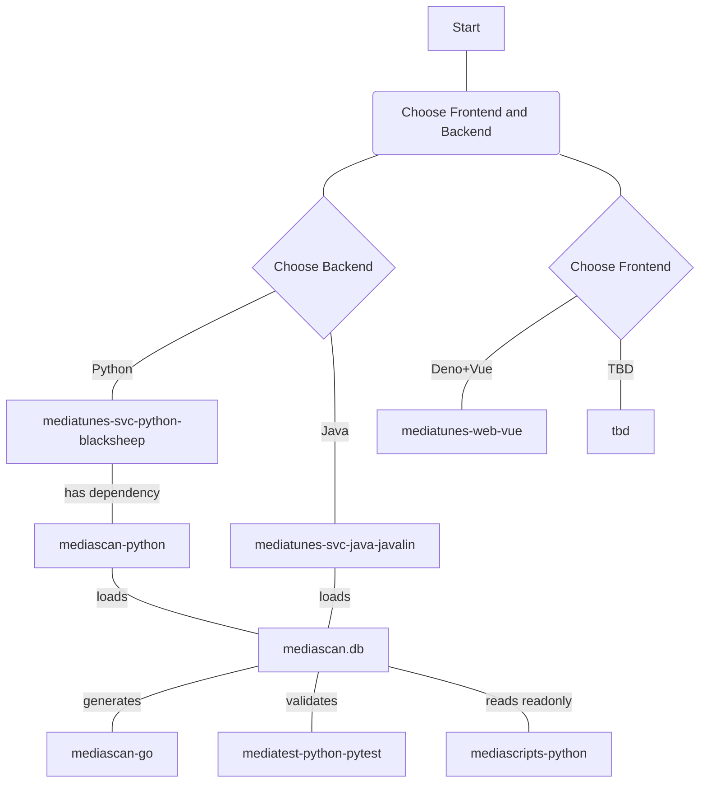

# moongas-mediascripts-python  

> 🚧 **Status: Work in Progress (WIP)**  
> This project is currently under active development. Features, APIs, and documentation are subject to change.

---

## Overview

**Python scripts for working with Moongas media collections.**

### A component of the `moongas` ecosystem of media library tools

- [moongas-collection-demo](https://github.com/moongas-org/moongas-collection-demo) [](https://github.com/moongas-org/moongas-collection-demo/actions/workflows/ci.yml) - Example Moongas media collection (metadata only)
- [moongas-mediatunes-web-vue](https://github.com/moongas-org/moongas-mediatunes-web-vue) [](https://github.com/moongas-org/moongas-mediatunes-web-vue/actions/workflows/ci.yml) - A Deno-tooled TypeScript/Vue SPA for Moongas hybrid media collections, pairing with the separate moongas-mediatunes-svc-python-blacksheep backend to seemlessly blend offline and streaming playback
- [moongas-mediatunes-svc-python-blacksheep](https://github.com/moongas-org/moongas-mediatunes-svc-python-blacksheep) [](https://github.com/moongas-org/moongas-mediatunes-svc-python-blacksheep/actions/workflows/ci.yml) - Python+BlackSheep implementation of API service for Moongas hybrid media collections—backend for Moongas mediatunes web application (moongas-mediatunes-web-vue)
- [moongas-mediatunes-svc-java-javalin](https://github.com/moongas-org/moongas-mediatunes-svc-java-javalin) [](https://github.com/moongas-org/moongas-mediatunes-svc-java-javalin/actions/workflows/ci.yml) - Java+Javalin implementation of API service for Moongas hybrid media collections—backend for Moongas mediatunes web application (moongas-mediatunes-web-vue)
- [moongas-mediascan-go](https://github.com/moongas-org/moongas-mediascan-go) [](https://github.com/moongas-org/moongas-mediascan-go/actions/workflows/ci.yml) - Golang module to scan media collections and Moongas Yaml metatadata, outputs Moongas database
- [moongas-mediascan-python](https://github.com/moongas-org/moongas-mediascan-python) [](https://github.com/moongas-org/moongas-mediascan-python/actions/workflows/ci.yml) - Python library with data classes for loading Moongas mediascan databases and Yaml metadata files
- [moongas-mediascripts-python](https://github.com/moongas-org/moongas-mediascripts-python) [](https://github.com/moongas-org/moongas-mediascripts-python/actions/workflows/ci.yml) - Python scripts for working with Moongas media collections.
- [moongas-mediatest-python-pytest](https://github.com/moongas-org/moongas-mediatest-python-pytest) [](https://github.com/moongas-org/moongas-mediatest-python-pytest/actions/workflows/ci.yml) - Python tool for enforcing media collection rules (implemented with `pytest`)

## Live Demos
- [Live Demo (hosted on moongas.org)](https://moongas.org/mediaserver)
- [Live Demo (hosted on moongas.org)](https://moongas.org/mediaserver)



# Quick Start

```bash
pip install "git+https://github.com/moongas-org/moongas-mediascripts-python.git[stats]"
```

### (Developer) Clone GitHub repo and install (editable)

```bash
git clone git@github.com:moongas-org/moongas-mediascan-python.git
cd moongas-mediascan-python
python -m pip install -e ".[dev,llm,stats]"
```

### Optional dependency groups

- `[dev]` - development dependencies (includes `pytest` and `ruff`)
- `[stats]` - statistics script dependencies (includes `matplotlib` and `numpy`)

# Usage

The `mediascripts` package installs a console script named `mediascripts` so it can be executed either with `python -m mediascripts` or simply with `mediascripts`.

```bash
$ mediascripts --h
usage: mediascripts [-h] [--list] [--create-script-symlinks]

Utility for media* console script entry points.

options:
  -h, --help            show this help message and exit
  --list                list all media* console script entry points, grouped by scripts subdirectory
  --create-script-symlinks
                        create hyphenated symlinks in the current directory to every console entry script and every shell script in
                        scripts/shell
```

The `--list` option may be used to list all console scripts and shell scripts installed by any `media*` packages.
```bash
$ mediascripts --list
artist:
  artist-countries-to-mapgraph-json
  artist-csv-to-artist-yaml
  artist-yaml-auto-populate
  artist-yaml-reformat-with-files-yaml
  artist-yaml-test-with-files-yaml
  list-missing-region-names
convert:
  convert-covers
  convert-videos
  make-covers-video
copy:
  copy-medialib
dev:
  generate-dataclasses
lyrics:
  lyrics-text-auto-populate
media_files_yaml:
  list-artists-from-files-yaml
  play-rand-file-from-files-yaml
mediascan_db:
  list-albums
  list-artists
  list-mediafiles
rename:
  rename-album-files
stats:
  genre-clusters
  mediastats
track:
  compare-track-yaml-with-media-file
  merge-track-yaml-with-media-file
```

## Compare Track YAML with MP3 Tags

With `MOONGAS_COLLECTION_ROOTDIR` set, run:

```bash
compare-track-yaml-with-media-file
compare-track-yaml-with-media-file --quiet
compare-track-yaml-with-media-file --dir "/path/to/music" --quiet
```

`-d` / `--dir` recursively scans the specified directory and all subdirectories,
without requiring `MOONGAS_COLLECTION_ROOTDIR` or a collection folder structure.
It takes precedence over the environment variable.

The script walks album directories under `$MOONGAS_COLLECTION_ROOTDIR/data`,
following library symlinks, and compares each MP3 with its sibling `<track>.yml`.
It uses Mutagen to compare the six core `trackData` fields: `title`, `artist`,
`albumartist`, `album`, `genre`, and `year` (against the ID3 date's year).
Leading/trailing whitespace is ignored; additional ID3 values are reported as
differences. Extra tags and streaming identifiers are not compared.

Tracks are skipped before reading YAML or media tags when their artist directory
contains any newline-separated keyword in `COPY_MEDIALIB_EXCLUDE_KEYWORDS`.
The YAML `artist` is also checked when the directory is not excluded. Matching is
case-sensitive, as in the copy scripts; blank lines are ignored. For example:

```bash
export COPY_MEDIALIB_EXCLUDE_KEYWORDS=$'Excluded Artist\nAnother Artist'
```

`-q` / `--quiet` suppresses matching tracks, but still reports differences,
missing YAML or tags, malformed YAML, and unreadable media files.
Files are never modified. Exit status is 0 if all tracks match, or 1 for any
difference or error. It also runs as
`python -m mediascripts.track.track_yaml.compare_track_yaml_with_media_file`.

## Merge Track YAML with MP3 Tags

```bash
merge-track-yaml-with-media-file
merge-track-yaml-with-media-file --dir "/path/to/music" --quiet
```

Uses the same recursive scanning, six-field comparison, and artist exclusions as
the comparison script. For each difference, it displays the track, field, and
both values, then asks you to type a shortcut followed by Enter:

| Shortcut | Choice | Effect |
|----------|--------|--------|
| `y` or Enter | Accept Track YAML (default) | Updates that ID3 tag from YAML |
| `m` | Accept Media File Tags | Updates that YAML field from ID3 |
| `e` | Enter value | Prompts for a value and saves it to both YAML and ID3 |
| `s` | Skip | Leaves that field unchanged |

Invalid shortcuts prompt again. Custom values cannot be blank; custom years
must contain four digits. Missing or multiple media values cannot be
copied into a single YAML field; choose YAML, Enter value, or Skip instead. ID3 dates are
compared by year; accepting media tags writes an integer YAML year, while
accepting the YAML year replaces the ID3 date with that year.

Each accepted field is saved immediately. Unrelated media tags and YAML fields,
comments, and quoted strings are preserved using round-trip YAML support.
YAML updates use a temporary file and atomic replacement. `--quiet` suppresses
matching tracks, not conflict prompts or errors. Ctrl+C or end-of-input stops
the run, preserving previously accepted changes.

Exit status is 0 if every conflict is resolved, 1 for skipped conflicts or
errors, and 130 when interrupted. Missing or malformed YAML and unreadable tags
are reported, not synthesized. You can also run
`python -m mediascripts.track.track_yaml.merge_track_yaml_with_media_file`.

## List Mediascan Database Tables

Set `MOONGAS_COLLECTION_ROOTDIR` to the active Moongas collection, then run:

```bash
list-artists
list-albums
list-mediafiles
```

These scripts use the `mediascan` library to open
`$MOONGAS_COLLECTION_ROOTDIR/mediascan.db` and print every row and column of the
`artist`, `album`, and `mediafile` tables, respectively, without modifying the
database. All headers and values are left-aligned, with no row, column, or value
truncation. The collection variable and an existing database file are required.

The modules can also be run with
`python -m mediascripts.mediascan_db.list_artists`,
`python -m mediascripts.mediascan_db.list_albums`, or
`python -m mediascripts.mediascan_db.list_mediafiles`.

## `scan-to-album-yaml` - Create Album YAML Files

With `MOONGAS_COLLECTION_ROOTDIR` set and `moongas-mediascan-go` available beneath
that directory, run:

```bash
mediascripts --create-script-symlinks
./scan-to-album-yaml
```

This uses the collection's `mediascan-config.yml` to create missing `album.yml`
files. Existing album YAML files are never overwritten. Additional arguments are
passed through to the Go scanner.

## `show-env` - Show Moongas Environment Variables
```bash
user@host:~/Git/moongas-org/moongas/moongas-collection-local$ ./show-env 
------------------------------------------------------------------------------
                             Moongas Environment                              
------------------------------------------------------------------------------
  MOONGAS_COLLECTION_ROOTDIR:
    "/home/user/Git/moongas-org/moongas/moongas-collection-local"
  MOONGAS_REMOTE_SERVER_IP:
    "159.89.93.193"
------------------------------------------------------------------------------

```
