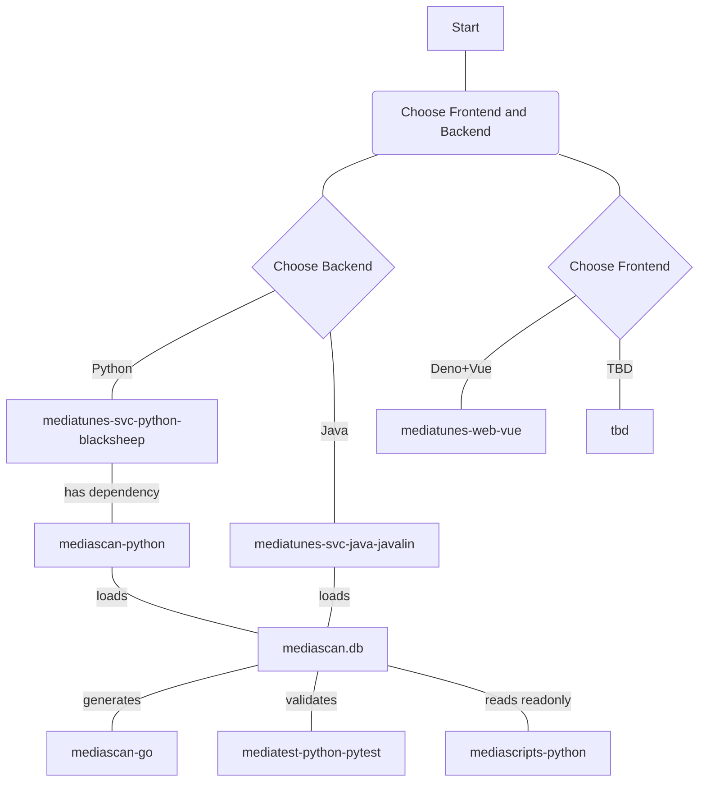

# moongas-mediascripts-python  

> 🚧 **Status: Work in Progress (WIP)**  
> This project is currently under active development. Features, APIs, and documentation are subject to change.

---

## Overview

**Python scripts for working with Moongas media collections.**

### A component of the `moongas` ecosystem of media library tools

- [moongas-collection-demo](https://github.com/moongas-org/moongas-collection-demo) [](https://github.com/moongas-org/moongas-collection-demo/actions/workflows/ci.yml) - Example Moongas media collection (metadata only)
- [moongas-mediatunes-web-vue](https://github.com/moongas-org/moongas-mediatunes-web-vue) [](https://github.com/moongas-org/moongas-mediatunes-web-vue/actions/workflows/ci.yml) - A Deno-tooled TypeScript/Vue SPA for Moongas hybrid media collections, pairing with the separate moongas-mediatunes-svc-python-blacksheep backend to seemlessly blend offline and streaming playback
- [moongas-mediatunes-svc-python-blacksheep](https://github.com/moongas-org/moongas-mediatunes-svc-python-blacksheep) [](https://github.com/moongas-org/moongas-mediatunes-svc-python-blacksheep/actions/workflows/ci.yml) - Python+BlackSheep implementation of API service for Moongas hybrid media collections—backend for Moongas mediatunes web application (moongas-mediatunes-web-vue)
- [moongas-mediatunes-svc-java-javalin](https://github.com/moongas-org/moongas-mediatunes-svc-java-javalin) [](https://github.com/moongas-org/moongas-mediatunes-svc-java-javalin/actions/workflows/ci.yml) - Java+Javalin implementation of API service for Moongas hybrid media collections—backend for Moongas mediatunes web application (moongas-mediatunes-web-vue)
- [moongas-mediascan-go](https://github.com/moongas-org/moongas-mediascan-go) [](https://github.com/moongas-org/moongas-mediascan-go/actions/workflows/ci.yml) - Golang module to scan media collections and Moongas Yaml metatadata, outputs Moongas database
- [moongas-mediascan-python](https://github.com/moongas-org/moongas-mediascan-python) [](https://github.com/moongas-org/moongas-mediascan-python/actions/workflows/ci.yml) - Python library with data classes for loading Moongas mediascan databases and Yaml metadata files
- [moongas-mediascripts-python](https://github.com/moongas-org/moongas-mediascripts-python) [](https://github.com/moongas-org/moongas-mediascripts-python/actions/workflows/ci.yml) - Python scripts for working with Moongas media collections.
- [moongas-mediatest-python-pytest](https://github.com/moongas-org/moongas-mediatest-python-pytest) [](https://github.com/moongas-org/moongas-mediatest-python-pytest/actions/workflows/ci.yml) - Python tool for enforcing media collection rules (implemented with `pytest`)

## Live Demos
- [Live Demo (hosted on moongas.org)](https://moongas.org/mediaserver)
- [Live Demo (hosted on moongas.org)](https://moongas.org/mediaserver)



# Quick Start

```bash
pip install "git+https://github.com/moongas-org/moongas-mediascripts-python.git[stats]"
```

### (Developer) Clone GitHub repo and install (editable)

```bash
git clone git@github.com:moongas-org/moongas-mediascan-python.git
cd moongas-mediascan-python
python -m pip install -e ".[dev,llm,stats]"
```

### Optional dependency groups

- `[dev]` - development dependencies (includes `pytest` and `ruff`)
- `[stats]` - statistics script dependencies (includes `matplotlib` and `numpy`)
- `[essentia]` - Essentia audio feature extraction (`pip install -e '.[essentia]'`)

# Usage

### AcoustID fingerprint lookup

Set `ACOUSTID_API_KEY` to your AcoustID client API key, then run:

```bash
acoustid                         # all track YAML files under $MOONGAS_COLLECTION_ROOTDIR/data
acoustid --dir /path/to/album     # recursively scan one directory
acoustid --file "/path/to/01 - Track.yml"
acoustid --count 10 --dry-run     # query up to 10 eligible tracks without writing
acoustid --force --dir /path/to/album  # re-query tracks that already have acoustidData
acoustid --force --overwrite --dir /path/to/album  # also rewrite unchanged lookup results
acoustid --dry-run --offline       # print request URLs without contacting AcoustID
python -m mediascripts.acoustid.acoustid --help
```

`--file` and `--dir` are mutually exclusive. Both `.yml` and `.yaml` files are
supported; collection metadata files such as `artist.yml`, `album.yml`, and
`files.yml` are excluded. A track must have a `trackData` mapping and a
`mediaFileData` entry containing `fpcalcData.fingerprint` and a positive numeric
`fpcalcData.duration` in seconds. Missing fingerprints or invalid durations are
warned about and skipped; this script does not run `fpcalc`.

`-c` / `--count` limits eligible tracks, not individual requests; zero processes
none. By default, fingerprint entries that already have non-empty `acoustidData`
are skipped without a request (logged at INFO), and tracks with nothing left to
look up don't count toward `--count`. Pass `--force` to query them again; a
response is replaced only when it changes.
All returned matches, scores, recording data, and additional response fields are
retained; no best-match selection is implied.

The script calls AcoustID over HTTPS with
`meta=recordingids&meta=releases&meta=releasegroups&meta=isrcs`, pacing requests
below the service's three-per-second limit within a single process. `--sleep`
sets the minimum seconds between requests; it defaults to `1/3 + 0.01`
(about 0.343) and rejects smaller values. Avoid running
multiple instances against the same API key. Each request's method, full URL,
headers, and timeout are logged, together with the HTTP status and full response
JSON pretty-printed with two-space indentation (including HTTP error bodies).
Invalid JSON is logged verbatim with a warning. The API key is redacted
throughout. `-n` / `--dry-run` still performs and logs lookups. For each proposed
change it writes a track YAML file in a unique `/tmp/acoustid-proposal-*`
directory and prints a shell-quoted `meld` command comparing the existing file
with the proposal. Source files and backups remain unchanged. Proposals remain
available for review; remove their temporary directories when finished.
Add `--offline` (only valid with `--dry-run`) to skip the API entirely: each
request URL the script would have sent is printed to stdout, with the API key
replaced by `[REDACTED]`, and no sleeping, proposals, or file changes occur.
`--count` and the existing-`acoustidData` skip still apply.

The successful API response is saved as `acoustidData` (the YAML spelling of
`MediaFileData.acoustid_data`) alongside `fpcalcData` in the matching
`mediaFileData` entry. ISRC lists are written independently, without YAML anchors
or aliases. Strings use the YAML writer's normal quoting rules. Only this portion is updated; existing metadata,
fingerprints, legacy identifier lists, other entries, and YAML comments are
preserved. `track-yaml-auto-populate` accepts and preserves this response.
Changed
files are saved atomically with an original-content `.bak` backup, and a
shell-quoted `meld` command compares the backup against the modified file.
Successful no-match responses (`results: []`) are saved too; identical responses
leave files unchanged unless `--overwrite` is specified. `--overwrite` rewrites
YAML after a successful lookup even when the response is unchanged, using the
usual backup and `meld` workflow (or a proposal in dry-run mode). It does not
force lookups for populated tracks; combine it with `--force` for that.
Rewriting lets the YAML writer remove unnecessary double quotes, while keeping
quotes required to preserve string types. Skipped tracks and offline runs are
not rewritten by this option. Errors are logged and produce a nonzero exit
status without saving the failed track.

### Spotify track identifiers

Set `SPOTIFY_API_CLIENT_ID` and `SPOTIFY_API_CLIENT_SECRET` to your Spotify
Developer application credentials, then run:

```bash
spotify                              # tracks under $MOONGAS_COLLECTION_ROOTDIR/data
spotify --file "/path/to/01 - Track.yml"
spotify --dir /path/to/album --count 10 --dry-run
spotify --dry-run --offline           # preview search URLs; no credentials needed
spotify --force --overwrite           # re-query populated entries and rewrite unchanged matches
python -m mediascripts.spotify.spotify --help
```

Spotify accepts the same mutually exclusive `--file` / `-d, --dir`,
`-c, --count`, `-n, --dry-run`, `--offline`, `--force`, `--overwrite`, and
`--sleep` options as AcoustID and MusicBrainz. Directory scans follow library
symlinks and exclude collection metadata files. The count limits eligible
track files, not individual ISRC requests.

Each `trackIdData.streamingData[]` entry is searched using its `isrc`,
followed by distinct ISRCs in
`mediaFileData[].acoustidData.results[].recordings[].isrcs`. Search values are
trimmed, uppercased, and stripped of hyphens without changing source ISRCs.
The first ISRC returning a match wins; if Spotify returns multiple tracks, the
first result is used. A `streamingData` entry with `streamingService: spotify`,
`trackId`, `trackUrl`, `apiData: null`, and the source `isrc` is added to the
scalar `trackIdData` mapping. If ISRCs are available only in `mediaFileData`,
they are associated with that mapping, which is created if needed.
Spotify response payloads, track metadata, and source ISRC values are not
modified. Malformed YAML is reported, not restored from backups, so unrelated
fields cannot be changed through automatic recovery.

Entries with a complete Spotify streaming record are skipped unless `--force`
is used. Incomplete records are filled when existing values agree with the
result; conflicting values are logged and left unchanged unless forced.
No-match results never erase existing fields. Successful searches, including
empty results, are cached per ISRC for the run, and failed ISRCs are not
retried again after exhausting their attempts.

Requests have a 30-second timeout and are spaced at least `--sleep` seconds
apart (default and minimum: 1.01). This is a conservative interval, not a
guarantee against Spotify's application-dependent rate limits. HTTP 429
`Retry-After` delays are honored. HTTP 503 adds 0.5 seconds of temporary extra
sleep; successful searches reduce it by 0.1 seconds. Expired-token HTTP 401
responses trigger reauthentication. Network errors, invalid responses, and
retryable HTTP errors get up to five attempts per ISRC; other 4xx responses
are not retried. Failures are logged and produce a nonzero exit status while
other entries and files continue processing.

Requests, statuses, and pretty-printed search responses are logged with bearer
tokens redacted; authentication bodies and credentials are never logged.
Changed files are saved atomically with an original-content `.bak` backup and
a shell-quoted `meld` command. Dry runs still query Spotify but retain proposals
under `/tmp/spotify-proposal-*`, print `meld` commands, and leave sources and
backups untouched; remove proposals when finished. Offline dry runs print
candidate search URLs without authentication, requests, sleeping, or writes.
`--overwrite` rewrites unchanged successful matches only; it does not bypass
the populated-entry skip, so combine it with `--force` when needed.

### MusicBrainz recording details

Run `musicbrainz` after `acoustid` to fill in each AcoustID recording's
MusicBrainz details. These are the optional `TrackAcoustIDRecording` fields
`title`, `length` (milliseconds), `video`, `disambiguation`, `firstReleaseDate`
(from MusicBrainz `first-release-date`), and `isrcs`:

```bash
musicbrainz                         # all track YAML files under $MOONGAS_COLLECTION_ROOTDIR/data
musicbrainz --file "/path/to/01 - Track.yml" --dry-run
musicbrainz --dry-run --offline     # print request URLs without contacting MusicBrainz
musicbrainz --force --overwrite     # rewrite even when recording details are unchanged
musicbrainz --reverse --count 10    # start with the last eligible tracks in normal traversal order
```

It accepts the same `--file`, `--dir`, `-c/--count`, `-n/--dry-run`,
`--offline`, `--force`, `--overwrite`, and `--sleep` options as `acoustid`.
Additionally, `--reverse` processes files in the exact reverse of the normal
collection or `--dir` traversal order, with `--count` applied in that reversed
order. It collects the discovered paths before processing; the default traversal
is unchanged. Recording order within each file is unchanged, and `--file` still
processes just that file. No API key is needed.
Each recording ID under `mediaFileData[].acoustidData.results[].recordings[]`
whose `isrcs` is missing or empty is requested from
`https://musicbrainz.org/ws/2/recording/<id>?inc=isrcs&fmt=json`. Recordings
with no ISRCs in MusicBrainz therefore keep an empty list and are checked again
on later runs. `--force` also re-queries recordings that already have ISRCs.
Requests are spaced at least 1.01 seconds apart (MusicBrainz allows one per
second), and IDs repeated within a run are requested only once. Each HTTP 503
adds 0.5 seconds of temporary extra sleep between requests; each later 2xx
response removes 0.1 seconds, down to zero. Requests, pretty-printed responses,
sleeps, and extra-sleep changes are logged.

Each recording ID gets at most five attempts per run, with the usual sleep
between them. HTTP errors other than 404, network errors, and invalid responses
each count as a failed attempt. After five failures that recording is left
unchanged and the script moves on to the next recording ID. Other recordings in
the same track are still saved, the ID isn't requested again later in the run,
and the exit status is nonzero. HTTP 404 is not retried and leaves that
recording unchanged. Invalid recording IDs are skipped with a warning.

Every field except `id` is replaced from the response; fields MusicBrainz omits
or returns as `null` are stored as `null` (`isrcs` as `[]`). Other keys are left
alone, and `id` is never changed, even when MusicBrainz returns a merged
recording. Saving, `.bak` backups, dry-run proposals
(`/tmp/musicbrainz-proposal-*`), and `meld` commands work as for `acoustid`. A
normal run replaces any existing `.bak`, including one written by `acoustid`.
`--overwrite` also rewrites unchanged recording details after a successful
lookup, including a result cached earlier in the run. Combine it with `--force`
to include recordings that already have ISRCs. Normal YAML quoting rules apply;
unnecessary double quotes are removed on rewrite. Skipped, offline, failed,
and not-found lookups do not trigger an overwrite.

Logs identify the track, each recording's progress and attempt number, and
whether its fields changed in memory. The track is saved only after all its
recording entries finish; `--overwrite` does not save after each response.
Completion logs explain whether YAML was written, a dry-run proposal was
created, or no write was needed, and include the `meld` command in the logs as
well as stdout. Interrupting a track discards its pending in-memory updates;
previously completed tracks remain saved.

Both lookup scripts expand existing shared ISRC lists even when a recording's
lookup would otherwise be skipped. Ordinary unquoted string lists are valid
and do not need repair. Missing optional
fields remain missing; an explicitly malformed ISRC value is logged and reset
to `[]`, allowing `musicbrainz` to look it up again. This repair does not consume
`--count` when no lookup is needed.

If a track YAML cannot be parsed and its `.bak` is a loadable track document,
the scripts restore that backup before processing it. A missing or invalid
backup causes an explicit error instead of overwriting the track. Dry runs
use the backup in memory and leave source files and backups untouched; offline
mode never writes repairs. Repaired output follows the usual backup/proposal
and `meld` workflow.

YAML `&id001` defines an anchor and `*id001` references it; these are valid YAML,
not ISRC strings. Sharing one cached list between recording entries previously
caused ruamel to emit these references. Each entry now gets an independent list,
and existing references are expanded without losing their identifiers.

The current source targets the reorganized sibling `moongas-mediascan-python`
API: metadata types and YAML helpers under `mediascan.types`, and database
loading under `mediascan.utils.db.mediascan_db_loader`. When developing against
that sibling checkout, install its current source into the same environment
(`pip install -e ../moongas-mediascan-python`); an older installed wheel may
still use the previous module layout.

The `mediascripts` package installs a console script named `mediascripts` so it can be executed either with `python -m mediascripts` or simply with `mediascripts`.

```bash
$ mediascripts --h
usage: mediascripts [-h] [--list] [--create-script-symlinks]

Utility for media* console script entry points.

options:
  -h, --help            show this help message and exit
  --list                list all media* console script entry points, grouped by scripts subdirectory
  --create-script-symlinks
                        create hyphenated symlinks in the current directory to every console entry script and every shell script in
                        scripts/shell
```

The `--list` option may be used to list all console scripts and shell scripts installed by any `media*` packages.
```bash
$ mediascripts --list
artist:
  artist-countries-to-mapgraph-json
  artist-csv-to-artist-yaml
  artist-yaml-auto-populate
  artist-yaml-reformat-with-files-yaml
  artist-yaml-test-with-files-yaml
  list-missing-region-names
convert:
  convert-covers
  convert-videos
  make-covers-video
copy:
  copy-medialib
dev:
  generate-dataclasses
lyrics:
  lyrics-text-auto-populate
media_files_yaml:
  list-artists-from-files-yaml
  play-rand-file-from-files-yaml
mediascan_db:
  list-albums
  list-artists
  list-mediafiles
rename:
  rename-album-files
stats:
  genre-clusters
  mediastats
track:
  compare-track-yaml-with-media-file
  merge-track-yaml-with-media-file
  track-yaml-auto-populate
```

## Auto-Populate Track YAML

The track YAML commands share collection scanning, atomic file writes, and
field-diff formatting through
[`track_yaml_common.py`](./src/mediascripts/track/track_yaml/track_yaml_common.py).

Install the LLM extras (`pip install -e '.[llm]'`) and configure an
OpenAI-compatible provider using `LLM_BASE_URL`, `LLM_API_KEY`, and `LLM_MODEL`.
The existing `GITHUB_MODELS_BASE_URL`, `GITHUB_TOKEN`, and `GITHUB_MODEL`
fallbacks are also supported, as for artist YAML auto-population.

```bash
track-yaml-auto-populate
track-yaml-auto-populate --file "/path/to/01 - Song.yml" --force
track-yaml-auto-populate --dir "/path/to/music" --sleep 10
track-yaml-auto-populate --dir "/path/to/music" --dry-run
track-yaml-auto-populate --count 10
track-yaml-auto-populate --llm=false
track-yaml-auto-populate --dir "/path/to/music" --clean
track-yaml-auto-populate --revert --dry-run
track-yaml-auto-populate --revert
```

By default, scans existing `.yml`/`.yaml` files in album directories beneath
`$MOONGAS_COLLECTION_ROOTDIR/data`, following library symlinks. `--dir` scans
any directory recursively; `--file` processes just one file. Artist, album,
and collection index YAML files are excluded. No media files are changed and
missing sidecars are not created.

Uses the mediascan `TrackYamlFile` schema: `trackData` contains `title`, `artist`,
`albumartist`, `album`, `genre`, and integer `year`; optional `trackIdData` is a
**mapping** containing a `streamingData` list. Each streaming entry has
`streamingService`, `trackUrl`, `trackId`, `apiData`, and optional `isrc`.
Optional `mediaFileData` contains local-file metadata, `fpcalcData` fingerprints,
and `acoustidData` results. Tracks with valid core metadata and at least one
non-empty streaming track ID or URL are skipped unless `--force` is used.
The LLM must preserve `mediaFileData` exactly; it cannot add or change audio
fingerprints, local-file metadata, or AcoustID data.
Up to three complete files in the selected scope serve as reference examples.
Pending tracks are shuffled and processed once per run, with 30 seconds between
requests by default. `--llm=false` only checks files, without creating a client
or changing anything.

`-n` / `--dry-run` requests updates from the LLM, validates the responses, and
shows the proposed diffs without modifying source files or backups.
Each changed result prints a shell-quoted `meld` command. In dry-run mode, the
proposal is retained in a private temporary YAML file so the command remains
usable after the script exits; remove that file when finished reviewing.
Normal runs compare the backup against the updated source.
Normal completion checks, `--force`, and request pacing still apply; this mode
uses provider credentials and may incur API charges. Use `--llm=false` instead
to check files without making requests.
With `--clean`, it logs which backups would be deleted without deleting them.
With `--revert`, it previews restoration without modifying either file.

`--revert` restores track `.yml.bak` files in album directories, replacing each
corresponding `.yml` file and consuming the backup. Replacement is atomic, so a
failed rename does not first delete the current file. Missing `.yml` files are
restored too. It follows library directory symlinks but rejects symlink backups.
It never restores `album.yml`, `artist.yml`, or collection index YAML files,
even with `--file`. `--dir` limits the scan; `--file` selects one track `.yml`
in an album directory. This mode exits without contacting the LLM, is mutually
exclusive with `--clean`, and is not limited by `--count`.

`-c` / `--count VALUE` limits processing to at most that many eligible tracks.
Skipped complete tracks do not count; failed attempts do. The default is
unlimited, and `--count 0` makes no LLM requests. The limit also applies to
dry-run previews, but does not limit backup cleanup with `--clean`.

Responses must pass schema validation and preserve existing non-empty metadata
and identifiers before being saved atomically. Unquoted decimal service IDs
returned by the model are converted to strings, preserving their original digits
(including leading zeros); other invalid identifier types are rejected with the
field path and offending value. Before saving, changed fields
are displayed with their `Track YAML` and `LLM Result` values, including indexed
identifier fields such as `trackIdData.streamingData[0].trackId`. A unified file-content diff
also shows the original/proposed filenames, context lines, and `-`/`+` YAML
lines, including during dry-run. This is informational;
no interactive confirmation is required. Changed files get a sibling
`.yml.bak`/`.yaml.bak` backup. `--clean` removes only track YAML backups in the
selected scope and exits. LLM results still require human review: schema checks
cannot establish that a suggested streaming identifier belongs to the recording.
Exit status is 0 on success, 1 for errors, or 130 if interrupted.
Also runs as `python -m mediascripts.track.track_yaml.track_yaml_auto_populate`.

## Compare Track YAML with MP3 Tags

With `MOONGAS_COLLECTION_ROOTDIR` set, run:

```bash
compare-track-yaml-with-media-file
compare-track-yaml-with-media-file --quiet
compare-track-yaml-with-media-file --dir "/path/to/music" --quiet
```

`-d` / `--dir` recursively scans the specified directory and all subdirectories,
without requiring `MOONGAS_COLLECTION_ROOTDIR` or a collection folder structure.
It takes precedence over the environment variable.

The script walks album directories under `$MOONGAS_COLLECTION_ROOTDIR/data`,
following library symlinks, and compares each MP3 with its sibling `<track>.yml`.
It uses Mutagen to compare the six core `trackData` fields: `title`, `artist`,
`albumartist`, `album`, `genre`, and `year` (against the ID3 date's year).
Leading/trailing whitespace is ignored; additional ID3 values are reported as
differences. Extra tags and streaming identifiers are not compared.

Tracks are skipped before reading YAML or media tags when their artist directory
contains any newline-separated keyword in `COPY_MEDIALIB_EXCLUDE_KEYWORDS`.
The YAML `artist` is also checked when the directory is not excluded. Matching is
case-sensitive, as in the copy scripts; blank lines are ignored. For example:

```bash
export COPY_MEDIALIB_EXCLUDE_KEYWORDS=$'Excluded Artist\nAnother Artist'
```

`-q` / `--quiet` suppresses matching tracks, but still reports differences,
missing YAML or tags, malformed YAML, and unreadable media files.
Files are never modified. Exit status is 0 if all tracks match, or 1 for any
difference or error. It also runs as
`python -m mediascripts.track.track_yaml.compare_track_yaml_with_media_file`.

## Merge Track YAML with MP3 Tags

```bash
merge-track-yaml-with-media-file
merge-track-yaml-with-media-file --dir "/path/to/music" --quiet
```

Uses the same recursive scanning, six-field comparison, and artist exclusions as
the comparison script. For each difference, it displays the track, field, and
both values, then accepts a single shortcut key immediately (no Enter needed):

| Shortcut | Choice | Effect |
|----------|--------|--------|
| `y` or Enter | Accept Track YAML (default) | Updates that ID3 tag from YAML |
| `m` | Accept Media File Tags | Updates that YAML field from ID3 |
| `e` | Enter value | Prompts for a value and saves it to both YAML and ID3 |
| `s` | Skip | Leaves that field unchanged |

Enter still selects the default, Accept Track YAML. After pressing `e`, type the
custom value and press Enter. Redirected/piped input retains line-based choices.
Invalid shortcuts prompt again. Custom values cannot be blank; custom years
must contain four digits. Missing or multiple media values cannot be
copied into a single YAML field; choose YAML, Enter value, or Skip instead. ID3 dates are
compared by year; accepting media tags writes an integer YAML year, while
accepting the YAML year replaces the ID3 date with that year.

Each accepted field is saved immediately. Unrelated media tags and YAML fields,
comments, and quoted strings are preserved using round-trip YAML support.
YAML updates use a temporary file and atomic replacement. `--quiet` suppresses
matching tracks, not conflict prompts or errors. Ctrl+C or end-of-input stops
the run, preserving previously accepted changes.

Exit status is 0 if every conflict is resolved, 1 for skipped conflicts or
errors, and 130 when interrupted. Missing or malformed YAML and unreadable tags
are reported, not synthesized. You can also run
`python -m mediascripts.track.track_yaml.merge_track_yaml_with_media_file`.

## List Mediascan Database Tables

Set `MOONGAS_COLLECTION_ROOTDIR` to the active Moongas collection, then run:

```bash
list-artists
list-albums
list-mediafiles
```

These scripts use the `mediascan` library to open
`$MOONGAS_COLLECTION_ROOTDIR/mediascan.db` and print every row and column of the
`artist`, `album`, and `mediafile` tables, respectively, without modifying the
database. All headers and values are left-aligned, with no row, column, or value
truncation. The collection variable and an existing database file are required.

The modules can also be run with
`python -m mediascripts.mediascan_db.list_artists`,
`python -m mediascripts.mediascan_db.list_albums`, or
`python -m mediascripts.mediascan_db.list_mediafiles`.

## `scan-to-album-yaml` - Create Album YAML Files

With `MOONGAS_COLLECTION_ROOTDIR` set and `moongas-mediascan-go` available beneath
that directory, run:

```bash
mediascripts --create-script-symlinks
./scan-to-album-yaml
```

This uses the collection's `mediascan-config.yml` to create missing `album.yml`
files. Existing album YAML files are never overwritten. Additional arguments are
passed through to the Go scanner.

## `show-env` - Show Moongas Environment Variables
```bash
user@host:~/Git/moongas-org/moongas/moongas-collection-local$ ./show-env 
------------------------------------------------------------------------------
                             Moongas Environment                              
------------------------------------------------------------------------------
  MOONGAS_COLLECTION_ROOTDIR:
    "/home/user/Git/moongas-org/moongas/moongas-collection-local"
  MOONGAS_REMOTE_SERVER_IP:
    "159.89.93.193"
------------------------------------------------------------------------------

```
